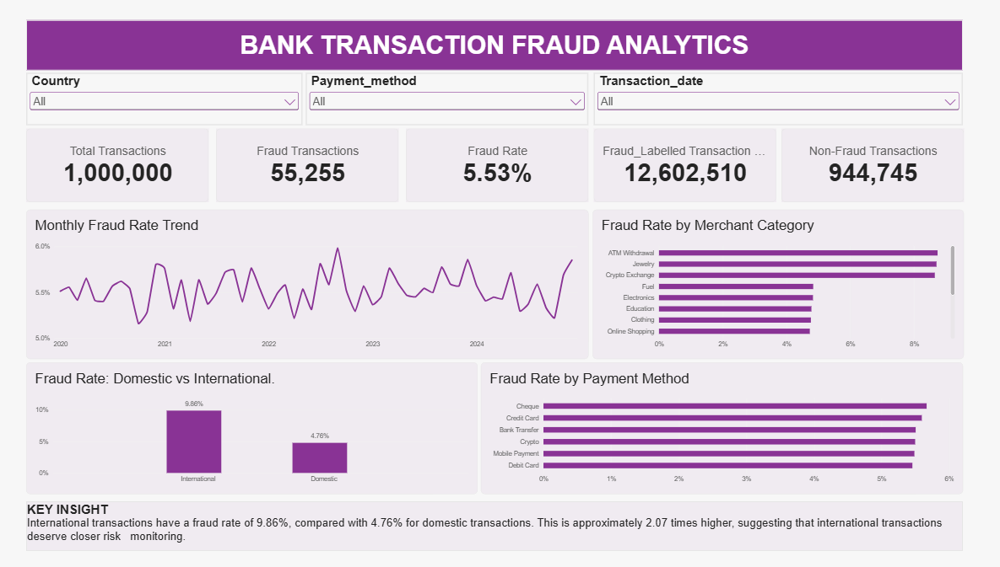
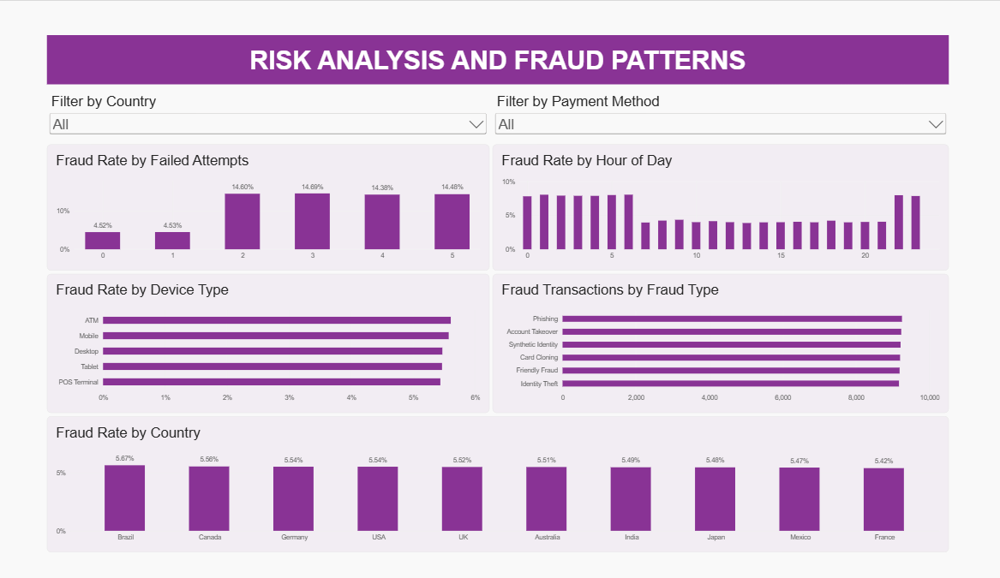

# Bank Transaction Fraud Analytics
### SQL Analysis & Power BI Risk Monitoring Dashboard

## 1. Project Overview

This project analyses 1,000,000 bank transaction records to investigate fraud patterns, examine transaction behaviour, and identify characteristics associated with higher fraud rates.

Using **MySQL 8.0.46** for database management, data validation, cleaning, and SQL analysis, alongside **Microsoft Power BI** for interactive reporting, the project transforms raw transaction data into meaningful insights that can support fraud risk monitoring and data-driven decision-making.

The analysis explores fraud occurrence across geographical locations, payment methods, merchant categories, devices, transaction periods, and other transaction characteristics.

## 2. Project Objectives

- Measure the occurrence and distribution of fraud-labelled transactions.
- Investigate fraud patterns across geographical locations and transaction characteristics.
- Identify transaction characteristics associated with higher fraud rates.
- Develop an interactive Power BI dashboard for fraud monitoring.
- Communicate findings through visualisations and data-driven recommendations.

## 3. Tools and Technologies

| Tool | Application |
|---|---|
| MySQL 8.0.46 | Database creation, data validation, data cleaning, and SQL analysis |
| Microsoft Power BI | Interactive dashboard development and reporting |
| DAX | Measures and calculated columns |
| GitHub | Version control and project documentation |

## 4. Dataset Description

**Dataset:** [Bank Transaction Fraud Detection Dataset – Kaggle](https://www.kaggle.com/datasets/nafiulislam490/bank-transaction-fraud-detection-dataset)

| Dataset Information | Details |
|---|---|
| Total records | 1,000,000 |
| Number of columns | 26 |
| Unique transaction IDs | 1,000,000 |
| Date coverage | January 2020 – December 2024 |
| File format | CSV |
| Dataset type | Synthetic |

The dataset contains transaction records with information about customers, transaction amounts, payment methods, merchant categories, geographical locations, device types, failed login attempts, and fraud indicators.

**Data disclaimer:** The dataset is synthetic and does not represent verified real-world banking transactions. The findings are limited to the supplied dataset and should not be interpreted as evidence of actual banking fraud patterns.

## 5. Project Workflow

The project followed a structured data analytics workflow, progressing from data acquisition and preparation to SQL investigation, dashboard development, and insight generation.

### 5.1 Data Acquisition and Understanding

Obtained the dataset from Kaggle and examined its structure to understand the available fields and their relevance to fraud analysis.

**Activities performed:**
- Downloaded and inspected the CSV dataset.
- Examined the dataset structure and its 26 columns.
- Identified `is_fraud` as the primary indicator for distinguishing fraud-labelled transactions from non-fraud-labelled transactions.
- Examined `fraud_type` and other categorical fields.
- Reviewed transaction, customer, payment, merchant, device, and geographical attributes.
- Established the transaction date coverage.

**Objective:** Understand the dataset and identify variables relevant to fraud analysis.

### 5.2 Database Creation and Data Importation

Used MySQL 8.0.46 to create a structured database and import the transaction records.

**Activities performed:**
- Created a database named `bank_fraud_analytics`.
- Created the `bank_transactions` table with the required 26 columns.
- Configured MySQL to support local file importation.
- Enabled `LOCAL INFILE` functionality.
- Launched the MySQL client through Command Prompt with local-infile support.
- Imported the CSV dataset using the `LOAD DATA LOCAL INFILE` statement.
- Reviewed the import execution summary.

**Importation results:**

| Import Metric | Result |
|---|---:|
| Records imported | 1,000,000 |
| Records deleted | 0 |
| Records skipped | 0 |
| Import warnings | 0 |

**Objective:** Establish a structured database environment for data preparation and analysis.

### 5.3 Data Validation and Quality Assessment

Performed SQL-based checks to assess the completeness, consistency, and integrity of the imported records.

**Activities performed:**
- Verified that the database contained exactly 1,000,000 transaction records.
- Confirmed the expected table structure and columns.
- Checked transaction ID uniqueness.
- Examined the dataset for NULL values and empty strings.
- Investigated the values recorded in categorical fields.
- Reviewed the fraud indicator and fraud classification fields.
- Checked the transaction date range.

**Key validation results:**
- All 1,000,000 transaction IDs were unique.
- No NULL or empty values were identified in the examined dataset fields.
- The `fraud_type` field contained the literal text `None` for non-fraud transactions.
- The dataset covered 60 months, from January 2020 to December 2024.

**Objective:** Identify potential data quality issues before analysis.

### 5.4 Data Cleaning and Preparation

**Data cleaning was a critical stage of this project.** Before conducting the analysis, the dataset underwent systematic quality checks and preparation to ensure that transaction records and categorical values were correctly interpreted.

The cleaning and preparation process covered the following areas:

**A. Missing Value Assessment**
- Examined the dataset for NULL values across the available fields.
- Checked for empty strings in the records.
- Confirmed that the examined fields contained no missing or empty values.
- Established that missing-value imputation was unnecessary.

**B. Duplicate Record Assessment**
- Checked transaction identifiers for duplicates.
- Confirmed that all 1,000,000 transaction IDs were unique.
- Established that no duplicate transaction identifiers required removal.

**C. Categorical Data Assessment**
- Examined categorical fields to understand their recorded values.
- Investigated the `fraud_type` field, particularly the use of `None`.
- Confirmed that `None` was a literal text value representing non-fraud transactions, rather than a SQL NULL value.
- Preserved this distinction during subsequent SQL analysis to prevent incorrect fraud classification.

**D. Fraud Indicator Assessment**
- Reviewed the `is_fraud` field to establish how fraud-labelled and non-fraud-labelled transactions were represented.
- Used the fraud indicator consistently in subsequent SQL calculations and comparisons.

**E. Date and Field Preparation**
- Reviewed the transaction date field and established the dataset's date coverage.
- Examined relevant fields to ensure they could be used consistently for geographical, payment, merchant, and behavioural analysis.

**Data Cleaning Outcome**

The assessment confirmed that the examined fields contained no missing or empty values and that all transaction identifiers were unique.

No records required deletion, missing-value replacement, or duplicate removal based on the checks performed.

Rather than making unnecessary changes to an already complete dataset, the cleaning process focused on identifying potential quality issues, validating field values, and ensuring correct interpretation of the data.

**Objective:** Ensure data quality, consistency, and readiness for reliable analysis.

### 5.5 Exploratory Data Analysis and SQL Investigation

SQL queries were used to investigate fraud occurrence, transaction behaviour, and patterns across different transaction characteristics.

The investigation was organised into seven SQL scripts:

| SQL Script | Analysis Performed |
|---|---|
| `01_data_validation.sql` | Validates the imported dataset and checks key data characteristics. |
| `02_data_quality_checks.sql` | Examines data completeness, uniqueness, and quality issues. |
| `03_fraud_overview.sql` | Analyses transaction volume, fraud counts, fraud rates, and fraud classifications. |
| `04_geographic_analysis.sql` | Investigates fraud occurrence and rates across countries. |
| `05_payment_merchant_analysis.sql` | Examines fraud patterns across payment methods and merchant categories. |
| `06_transaction_behaviour_analysis.sql` | Investigates transaction behaviour, including time-based and other transaction characteristics. |
| `07_risk_patterns_analysis.sql` | Examines risk-related characteristics, including failed attempts and account age. |

**Objective:** Identify measurable fraud patterns and relationships within the dataset.

### 5.6 SQL Results Validation and Interpretation

Reviewed the results generated from the SQL investigations to ensure consistency with the underlying transaction records.

**Activities performed:**
- Cross-checked transaction counts and fraud counts.
- Verified fraud-rate calculations against their underlying transaction totals.
- Reviewed fraud classifications and category-level results.
- Compared findings across different analytical queries.
- Identified key findings for presentation in Power BI.

**Objective:** Ensure that analytical findings were consistent and interpretable.

### 5.7 Power BI Integration and Dashboard Development

Connected Power BI to the MySQL database and developed an interactive reporting solution using the `bank_transactions` table.

**Activities performed:**
- Connected Power BI to MySQL.
- Loaded the transaction table into Power BI.
- Created DAX measures for total transactions, fraud transactions, non-fraud transactions, fraud rate, and fraud-labelled transaction value.
- Created a calculated column to classify transactions as Domestic or International.
- Developed an hourly fraud-rate measure.
- Configured visual fields, aggregations, and percentage formatting.
- Arranged the visuals into two analytical report pages.

**Objective:** Transform SQL findings into an interactive analytical report.

### 5.8 Dashboard Design and Analytical Presentation

The Power BI report was organised into two pages to separate overall fraud monitoring from detailed risk analysis.

**Page 1: Fraud Overview**

Designed to provide a high-level summary of transaction activity and fraud occurrence.

Visualisations and components:
- Total Transactions KPI.
- Fraud Transactions KPI.
- Non-Fraud Transactions KPI.
- Fraud Rate KPI.
- Fraud-Labelled Transaction Value KPI.
- Monthly Fraud Rate Trend (2020–2024).
- Fraud Rate by Merchant Category.
- Fraud Rate by Payment Method.
- Domestic vs International Fraud Rate.
- Country, Payment Method, and Transaction Date slicers.
- Key insight highlighting the difference between domestic and international fraud rates.

**Page 2: Risk Analysis & Fraud Patterns**

Designed to provide a deeper examination of transaction characteristics associated with fraud.

Visualisations and components:
- Fraud Rate by Failed Attempts.
- Fraud Rate by Country.
- Fraud Rate by Device Type.
- Fraud Transactions by Fraud Type.
- Fraud Rate by Hour of Day.
- Country and Payment Method slicers.

**Objective:** Present the findings in a clear and accessible visual format.

### 5.9 Interactive Reporting and Final Review

Configured and tested the report's interactive filtering features to ensure a consistent user experience.

**Activities performed:**
- Added slicers for relevant report dimensions.
- Configured visual interactions.
- Used Power BI's Sync slicers functionality to synchronise Country, Payment Method, and Transaction Date filters across both report pages.
- Tested filtering from Fraud Overview to Risk Analysis.
- Tested filtering in the reverse direction.
- Confirmed that dashboard visuals responded to the relevant filter selections.
- Compared the dashboard's key figures with the previously validated SQL results.
- Saved the completed Power BI report.

**Objective:** Deliver a consistent and interactive reporting experience.

## 6. Key Findings

The SQL analysis produced the following results:

| Metric | Result |
|---|---:|
| Total transactions | 1,000,000 |
| Fraud-labelled transactions | 55,255 |
| Non-fraud-labelled transactions | 944,745 |
| Overall fraud rate | 5.53% |
| Fraud-labelled transaction value | 12,602,509.65 |

### 6.1 International vs Domestic Transactions

International transactions recorded a higher fraud rate than domestic transactions.

| Transaction Type | Fraud Rate |
|---|---:|
| Domestic | 4.76% |
| International | 9.86% |

The international transaction fraud rate was approximately 2.07 times the domestic rate.

### 6.2 Failed Login Attempts

Transactions associated with two or more failed attempts recorded substantially higher fraud rates than transactions with zero or one failed attempt.

| Failed Attempts | Fraud Rate |
|---|---:|
| 0 | 4.52% |
| 1 | 4.53% |
| 2 | 14.60% |
| 3 | 14.58% |

### 6.3 Merchant Category Analysis

Some of the highest merchant-category fraud rates were:

| Merchant Category | Fraud Rate |
|---|---:|
| ATM Withdrawal | 8.74% |
| Jewelry | 8.70% |
| Crypto Exchange | 8.65% |

### 6.4 Transaction Timing

Nighttime transactions recorded higher fraud rates than daytime transactions across both weekdays and weekends.

### 6.5 Geographic Analysis

Fraud rates were relatively close across countries.

- Highest country-level fraud rate: Brazil (5.67%).
- Lowest country-level fraud rate: France (5.42%).
- Highest fraud count: United States (16,617).

The country with the highest fraud count was not necessarily the country with the highest fraud rate.

### 6.6 Monthly Fraud Trend

- Highest monthly fraud rate: September 2022 (5.98%).
- Lowest monthly fraud rate: October 2020 (5.16%).

The analysis did not indicate a clear sustained upward or downward trend.

## 7. Business Recommendations

Based on the patterns observed in the dataset:

- Give additional monitoring attention to international transactions.
- Consider failed login attempts as a factor for further transaction risk investigation.
- Monitor merchant categories with relatively higher fraud rates.
- Examine transaction timing as one of several potential risk indicators.
- Evaluate multiple transaction characteristics together rather than relying on a single variable when assessing potential fraud risk.

These recommendations are analytical suggestions derived from the dataset, not validated fraud-prevention rules.

## 8. Dashboard Visualisation

The following dashboards present the results of the SQL analysis through interactive Power BI visualisations.

### 8.1 Fraud Overview Dashboard

The Fraud Overview dashboard presents overall transaction activity, fraud distribution, monthly fraud trends, and comparisons across merchant categories, payment methods, and transaction types.



### 8.2 Risk Analysis & Fraud Patterns Dashboard

The Risk Analysis dashboard provides a deeper examination of fraud patterns across failed login attempts, geographical locations, device types, fraud classifications, and transaction hours.



## 9. Repository Structure

```text
bank-transaction-fraud-analytics/
│
├── Images/
│   ├── fraud-overview.png
│   └── risk-analysis.png
│
├── SQL/
│   ├── 01_data_validation.sql
│   ├── 02_data_quality_checks.sql
│   ├── 03_fraud_overview.sql
│   ├── 04_geographic_analysis.sql
│   ├── 05_payment_merchant_analysis.sql
│   ├── 06_transaction_behaviour_analysis.sql
│   └── 07_risk_patterns_analysis.sql
│
├── POWER_BI_DASHBOARD.md
└── README.md
```

- **Images:** Contains screenshots of the two Power BI dashboard pages.
- **SQL:** Contains the seven SQL scripts used for data validation, quality assessment, and fraud analysis.
- **POWER_BI_DASHBOARD.md:** Provides access to the downloadable Power BI dashboard file.
- **README.md:** Contains the project documentation, workflow, analytical findings, and dashboard visualisations.


## 10. Project Limitations

- The dataset is synthetic and does not represent verified real-world banking transactions.
- Findings reflect patterns within the supplied dataset and may not generalise to actual financial institutions.
- Fraud-labelled transaction value represents the value of transactions marked as fraudulent in the dataset. It is not confirmed financial loss.
- The analysis identifies associations and patterns; it does not establish causation.
- This project is an analytical reporting exercise, not a production fraud detection system or predictive machine learning model.

## 11. Project Deliverables

- MySQL database containing 1,000,000 transaction records.
- Seven SQL scripts covering data validation, quality assessment, and fraud analysis.
- Power BI dashboard containing two interactive report pages.
- DAX measures and calculated columns.
- Documented analytical findings and risk-monitoring recommendations.
- - [Download Power BI Dashboard (.pbix)](https://drive.google.com/file/d/12iXPNYdpH6OMTet4-EeePFUFySAmhBpD/view?usp=sharing)

## 12. Author

**Cyrus Fayomi**

Information & Communication Science Graduate | Data Analysis | SQL | Power BI

[GitHub Profile](https://github.com/Cyrusfayomi)
